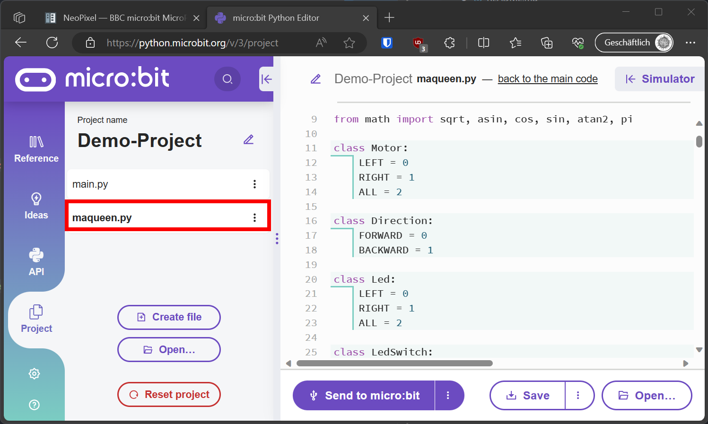

# Maqueen Plus v2
Library to control maqueen plus v2 with micro:bit and micropython.

## Dev: Versions
For changes in the API:
- minor version: no breaking changes, bug fixes, mostly irrelevant new features
- major version: breaking changes, new features

To release a new Version:
1. [preparation] update the `version` comment (first Line) in `maqueen.py`
2. [preparation] describe the changes in [website/docs/api/index.md](website/docs/api/index.md#changelog)
3. commit all changes
4. [docs] create a new Documentation Version (e.g `2.0.1`): `(cd website && yarn docusaurus docs:version 2.0.1)`
5. commit and tag the version (e.g. `v2.0.1`)
6. push the changes and the tag to github

Github will build and deploy the new version of the documentation automatically.

## Installation
Copy the file `maqueen.py` to your project folder micro:bit.



And import the library in your code in `main.py`:

```python
from maqueen import *

motor_run(Motor.LEFT, 100)
sleep(150)
motor_stop(Motor.LEFT)
motor_run(Motor.RIGHT, 100)
sleep(150)
motor_stop(Motor.RIGHT)
```

## API

### Motor

```py
class Motor:
    LEFT = 0
    RIGHT = 1
    ALL = 2

class Direction:
    FORWARD = 0
    BACKWARD = 1
```

#### `motor_run(motor: int, speed: int, dir: int = Direction.FORWARD)`
Run the motor in the specified direction and speed.

- `speed`: -255 to 255
- `dir`: Direction.FORWARD or Direction.BACKWARD

A negative speed will run the motor in the opposite direction.

```py
# run left motor forward at 100% speed
motor_run(Motor.LEFT, 255)
# run right motor backward at 50% speed
motor_run(Motor.RIGHT, 128, Direction.BACKWARD)
# or equivalent
motor_run(Motor.RIGHT, -128)

# run both motors forward at 100% speed
motor_run(Motor.ALL, 255)
```

#### `motor_stop(motor: int = Motor.ALL)`

Stops both (default) motors or the selected motor.

```py
# stop both motors
motor_stop()
# stop left motor
motor_stop(Motor.LEFT)
```

#### `motor_calibration(motor: int, calibration: list[tuple[float, float]])`

The motors of the maqueen are not perfectly aligned. Therefore, a calibration can be applied to correct the speed of the motors.
You can set one or more calibration points for each motor. The calibration points are tuples of the form `(speed, correction)`. The correction is a factor that is multiplied with given motor speeds. A correction of `1` means that the motor will not be corrected. A correction of 0.5 means that the motor will run at half the speed.

```py
# set calibration for left motor with 2 calibration points. Correction factors are interpolated linear.
motor_calibration(Motor.LEFT, [(25, 1.3), (200, 1.2)])
# set calibration for right motor with 1 calibration point
motor_stop(Motor.RIGHT, [(100, 1.1)])
# reset calibration for left motor
motor_calibration(Motor.LEFT, [])

# add multiple calibration points. The correction factors are interpolated linear
motor_calibration(Motor.LEFT, [(25, 1.3), (50, 1.2), (100, 1.4), (200, 1.0)]) # => correction factor for speed 75 is 1.3
```

### LED's

```py
class Led:
    LEFT = 0
    RIGHT = 1
    ALL = 2


class ColorLED:
    L1 = 0
    L2 = 1
    R2 = 2
    R1 = 3
    ALL = 4

class Color:
    RED = 0xFF0000
    ORANGE = 0xFFA500
    YELLOW = 0xFFFF00
    GREEN = 0x00FF00
    BLUE = 0x0000FF
    INDIGO = 0x4B0082
    VIOLET = 0x8A2BE2
    PURPLE = 0xFF00FF
    WHITE = 0xFFFFFF
    BLACK = 0x000000
```

#### `led_red(on: bool, led: int = Led.ALL)`

Turns on or off the red led in front of the Maqueen.

By default, it turns on or off both leds.

```py
led_red(True)
# turn off left led
led_red(False, Led.LEFT)
```

#### `led_rgb(rgb: int, led: int = ColorLED.ALL, brightness: int = _brightness)`
Turns on the RGB led in the specified color. By default the same color is used for all 4 leds.

The color leds are arranged as follows:
```
   /''''^''''\
  /  L1   R1  \
 |             |
 |L2         R2|
o|.............|o
```

```py
# turn on all leds in red
led_rgb(Color.RED)
# turn on upper left led in green
led_rgb(Color.GREEN, ColorLED.L1)
# use a custom color
led_rgb(rgb(255, 128, 0), ColorLED.R1)
# use a specific brightness [0-255]. By default, the global brightness is used.
led_rgb(Color.BLUE, brightness=50) # does not change the global brightness
```

#### `led_brightness(brightness: int)`
Sets the global brightness of the RGB leds.

```py
led_brightness(255) # full brightness
led_brightness(0) # leds off
```

#### `led_rgb_off(led: int = ColorLED.ALL)`

Sets the RGB led to black (off, `0`).

```py
led_rgb_off() # turn off all leds
led_rgb_off(ColorLED.L2) # turn off lower left led
```

#### `rgb(r: int, g: int, b: int)`
Helper function to convert a rgb color to an int

```py
rgb(255, 128, 0) # => 16744448  (its hex value is 0xFF8000)
```

### Line Tracking

```py
class LineSensor:
    L1 = 0
    M = 1
    R1 = 2
    L2 = 3
    R2 = 4
```

#### `line_sensor(sensor: int)`
Returns the value of the specified line tracking sensor.

```
   /''''^''''\
  /  L1 M R1  \
 |             |
 |L2         R2|
o|.............|o
```

```py
line_sensor(LineSensor.M) # => 0 or 1
```

When `LineSensor.ALL` is used, a 5-tuple with values of all sensors is returned. The order is clockwise starting with the leftmost sensor: `(L2, L1, M, R1, R2)`

```py
line_sensor(LineSensor.ALL) # => tuple of all sensors, (0, 1, 1, 0, 1)
                            # => L1, M and R2 are on the line
```

#### `line_sensor_data(sensor: int)`
Returns the raw data of the specified line tracking sensor.

```py
line_sensor_data(LineSensor.M) # => 0-1023
```

When `LineSensor.ALL` is used, a 5-tuple with values of all sensors is returned. The order is clockwise starting with the leftmost sensor: `(L2, L1, M, R1, R2)`

```py
line_sensor_data(LineSensor.ALL) # => tuple of all sensors, (12, 1023, 721, 23, 222)
                                 # => All sensors read a value between 0 and 1023
```

### Ultrasonic Sensor

#### `ultrasonic()`
Returns the distance in centimeters.

```py
ultrasonic() # => 0-500
```

When the ultrasonic sensor is not connected to the default trigger `pin13` and echo `pin14`, you can specify the pins as arguments.

```py
ultrasonic(trig=pin0, echo=pin1) # => 0-500
```

### Version
Returns the version of the maqueen platform.

```py
version() # => 'MBT0021-EN-2.1'
```
