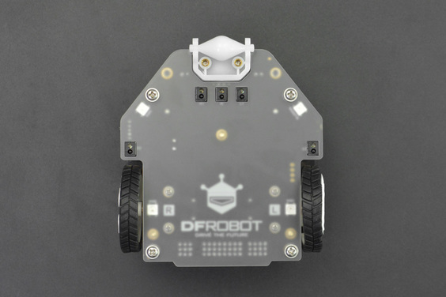
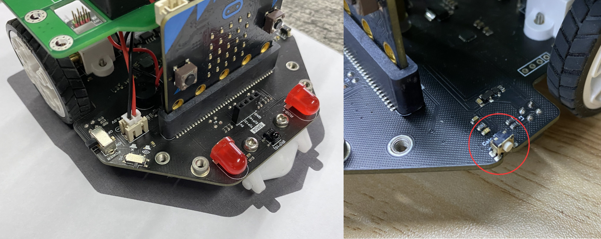

# Liniensensor



Für die Steuerung des Liniensensors kann die Funktion `line_sensor` verwendet werden.

## API

Für die Liniensensoren können folgende Konstanten benutzt werden:

```py
class LineSensor:
    L1 = 0
    M = 1
    R1 = 2
    L2 = 3
    R2 = 4
```

### `line_sensor(sensor)`
Gibt für den angegebenen Liniensensor an, ob er Schwarz (=`1`) oder Weiss (=`0`) sieht.

Aus der Vogelperspektive sind die Sensoren wie folgt angeordnet:

```
   /''''^''''\
  /  L1 M R1  \
 |             |
 |L2         R2|
o|.............|o
```

#### Parameter
`sensor: int`
: `LineSensor.L1`
: `LineSensor.M`
: `LineSensor.R1`
: `LineSensor.L2`
: `LineSensor.R2`


#### Beispiel

Den mittleren Sensor abfragen:

```py
line_sensor(LineSensor.M) # => 0 oder 1
```

### `line_sensor_all()`

Mit `line_sensor_all` wird ein 5-Tupel mit den Werten von allen Fünf Liniensensoren zurückgegeben. Die Reihenfolge ist im Uhrzeigersinn, beginnend mit dem linken Sensor: `(L2, L1, M, R1, R2)`

#### Beispiel

```py
line_sensor_all()   # => Tupel aller Sensorwerte, (0, 1, 1, 0, 1)
                    #    -> L1, M und R2 sind auf der Linie
```

### `line_sensor_data(sensor)`
Gibt die Rohdaten des angegebenen Liniensensors zurück. Je näher der Sensorwert bei `0` ist, desto dunkler ist die gemessene Farbe. Je näher der Wert bei `255` ist, desto heller ist die gemessene Farbe. Für die Unterscheidung von Schwarz und Weiss kann bspw. folgender Schwellwert verwendet werden: 

schwarz
: `< 100`
weiss
: `> 100`

#### Parameter
`sensor: int`
: `LineSensor.L1`
: `LineSensor.M`
: `LineSensor.R1`
: `LineSensor.L2`
: `LineSensor.R2`

#### Beispiel
```py
line_sensor_data(LineSensor.M) # => 0-256
```

### `line_sensor_data_all()`
Mit der Funktion `line_sensor_data_all` wird ein 5-Tupel mit den Rohwerten von allen 5 Liniensensoren zurückgegeben. Die Reihenfolge ist im Uhrzeigersinn, beginnend mit dem linken Sensor: `(L2, L1, M, R1, R2)`

#### Beispiel

```py
line_sensor_data_all()  # => Tupel aller Sensorwerte (12, 130, 50, 72, 77)
                        # => Alle Sensoren messen Werte zwischen 0 und 255
```

## Kalibrierung der Liniensensoren

Die Liniensensoren wurden im Werk kalibriert. Sollte die Kalibrierung nicht mehr präzise sein, können die Sensoren neu kalibriert werden.
1. Maqueen auf einer schwarzen Fläche positionieren (bspw. auf der Rückseite der beigelegten *Track Map*) 
2. Den *Calibration Key* **5 Sekunden** gedrückt halten



### Software-Kalibrierung

Die Hardware-Kalibrierung funktioniert schlecht, wenn die einzelnen Liniensensoren unterschiedliche Rohwerte liefern. In diesem Fall kann zusätzlich eine Software-Kalibrierung verwendet werden: Für jeden Sensor wird ein eigener Schwellwert gespeichert.

Ist eine Software-Kalibrierung vorhanden, verwenden `line_sensor` und `line_sensor_all` die kalibrierten Schwellwerte. Ein Sensor gibt Schwarz (=`1`) zurück, wenn sein Rohwert kleiner oder gleich `Schwellwert + Toleranz` ist (höchstens `255`), sonst Weiss (=`0`).

Die Kalibrierung wird in der Datei `line_calibration.txt` auf dem micro:bit gespeichert und beim Import von `maqueen` automatisch geladen. Sie bleibt beim Neustart und beim Ausschalten erhalten.

:::warning[Neues Programm hochladen]
Beim Hochladen eines neuen Programms wird das Dateisystem des micro:bits gelöscht und damit auch die Kalibrierung. Sollen die Werte dauerhaft erhalten bleiben, können sie mit `get_calibration()` ausgegeben und im Programm mit `calibrate([...])` fest eingetragen werden.
:::

### `recalibrate()`

Startet den Kalibrierungsmodus. Der Maqueen wird dazu so positioniert, dass **alle fünf Liniensensoren auf einer schwarzen Fläche** stehen.

Knopf A
: Die Rohwerte werden während 3 Sekunden gemessen (Anzeige `3`, `2`, `1`).
: Weichen die Messwerte jedes Sensors um höchstens 8% von seinem Mittelwert ab, war die Kalibrierung erfolgreich: Es wird für 2 Sekunden ein ✓ angezeigt und die Mittelwerte werden als Schwellwerte gespeichert.
: Sonst wird für 2 Sekunden ein ✗ angezeigt und die bisherige Kalibrierung bleibt bestehen.

Knopf B
: Beendet den Kalibrierungsmodus.

Solange nicht gemessen wird, zeigt die oberste Zeile der LED-Matrix an, ob ein Sensor Schwarz (LED an) oder Weiss (LED aus) sieht. So kann die Kalibrierung direkt überprüft werden.

#### Parameter
`duration_s: int = 3`
: Messdauer in Sekunden.

`tolerance: float = 0.08`
: Erlaubte Abweichung der Messwerte vom Mittelwert (`0.08` = 8%, mindestens aber `±3`).

`margin: int = 20`
: Toleranz, die zum Schwellwert addiert wird.

#### Beispiel

```py
from maqueen import *

recalibrate()   # A: kalibrieren, B: weiter

while True:
    print(line_sensor_all())
```

### `calibrate(thresholds, margin, persist)`

Setzt die Schwellwerte der Software-Kalibrierung direkt. Wird `calibrate()` ohne Schwellwerte aufgerufen, wird die Kalibrierung gelöscht und wieder die Hardware-Auswertung verwendet.

#### Parameter
`thresholds: list = None`
: Liste mit den 5 Schwellwerten in der Reihenfolge `(L2, L1, M, R1, R2)`

`margin: int = 20`
: Toleranz, die zum Schwellwert addiert wird.

`persist: bool = True`
: `True`: Die Kalibrierung wird auf dem micro:bit gespeichert.
: `False`: Die Kalibrierung gilt nur bis zum nächsten Neustart.

#### Beispiel

```py
calibrate([40, 42, 38, 45, 41])     # Schwellwerte setzen
calibrate([40, 42, 38, 45, 41], margin=30, persist=False)
calibrate()                         # Kalibrierung löschen
```

### `get_calibration()`

Gibt die aktuellen Schwellwerte in der Reihenfolge `(L2, L1, M, R1, R2)` zurück, oder `None`, wenn keine Software-Kalibrierung vorhanden ist.

#### Beispiel

```py
get_calibration()   # => [40, 42, 38, 45, 41]
```

### `show_line_state(sleep_for)`

Zeigt in der obersten Zeile der LED-Matrix an, ob die Liniensensoren Schwarz (LED an) oder Weiss (LED aus) sehen. Die Anzeige ist gespiegelt: `L2` ist ganz rechts, `R2` ganz links.

#### Parameter
`sleep_for: int = 50`
: Wartezeit in Millisekunden nach dem Aktualisieren der Anzeige (`0` = nicht warten).

#### Beispiel

```py
while True:
    show_line_state()
```
